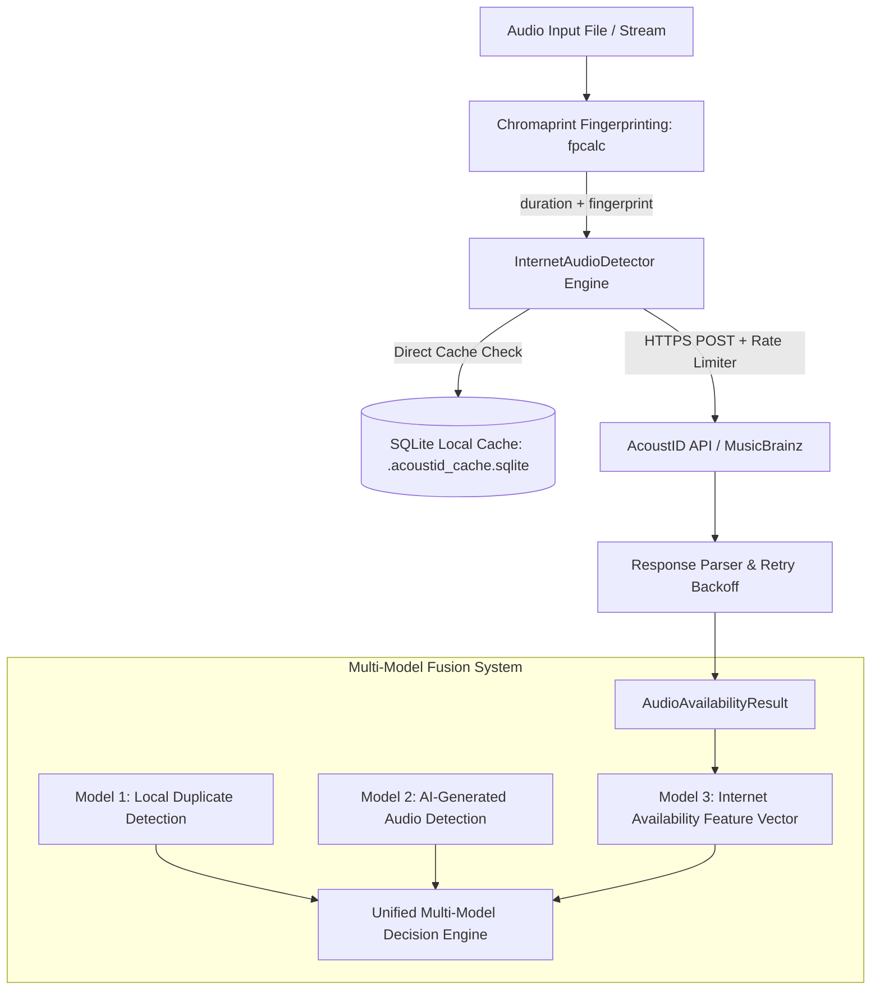

# Internet Audio Availability Detector (Chromaprint + AcoustID)

An open-source, resilient audio intelligence component that checks whether a given audio recording exists on the internet (MusicBrainz database, YouTube, commercial streaming platforms, and broadcast databases) using **Chromaprint acoustic fingerprints** and the **AcoustID lookup web service**.

This component is designed as **Model 3** in a unified **3-Model Audio Verification System**:
1. **Model 1: Duplicate Audio Detection** (Local database HNSW / neural embeddings)
2. **Model 2: AI-Generated Audio Detection** (Synthetic artifact and vocoder detection)
3. **Model 3: Internet Audio Availability Detection** (Global web lookup via AcoustID & MusicBrainz)

---

## The Core Insight

AcoustID is the official global lookup service for Chromaprint fingerprints. By computing an acoustic fingerprint and submitting the `(fingerprint, duration)` tuple to AcoustID's Web API, the service searches hundreds of millions of tracks and returns:
- **Match Confidence Score** (0.0 to 1.0)
- **AcoustID Track UUID** & Direct Web URL (`https://acoustid.org/track/<uuid>`)
- **MusicBrainz Metadata**: Song title, artist names, album releases, and MusicBrainz Recording IDs (MBID)
- **Non-Match Status**: Returns empty results for synthetic/unindexed recordings

---

## Architecture & Multi-Model Fusion



---

## 100-File Benchmark Summary

The pipeline was benchmarked against **100 diverse audio recordings** across 5 distinct domains:

| Metric | Result |
| :--- | :--- |
| **Total Files Tested** | **100** |
| **Found on Internet (Available)** | **8 (8.0%)** |
| **Not Found on Internet** | **92 (92.0%)** |
| **Errors Encountered** | **0 (0.0%)** |
| **Average Match Confidence (when match)** | **0.8343** (peaks at **0.967**) |
| **Total Benchmark Wall Time** | **41.71 seconds** (~0.417s per file) |
| **Average Live Query Latency** | **436.8 ms** (Median: 325.4 ms) |
| **Cache Hit Latency** | **0.0 ms** (< 1 ms local SQLite lookup) |

### Domain Breakdown

| Category | Total Files | Available Online | Detection Rate | Avg Score |
| :--- | :---: | :---: | :---: | :---: |
| **GTZAN Commercial Music** | 40 | 7 | 17.5% | 0.865 |
| **DESED YouTube Audio Clips** | 20 | 1 | 5.0% | 0.621 |
| **AI-Generated Synthetic Audio** | 20 | 0 | 0.0% | 0.000 |
| **LibriSpeech Spoken Audio** | 10 | 0 | 0.0% | 0.000 |
| **ESC-50 Environmental Audio** | 10 | 0 | 0.0% | 0.000 |

#### Notable Detections
- `pop.00003.au` $\rightarrow$ Identified as **`"HAND IN MY POCKET"`** by **Alanis Morissette** (Score: 0.640)
- `reggae.00002.au` $\rightarrow$ Identified as **`"COULD YOU BE LOVED"`** by **Bob Marley** (Score: 0.651)
- `reggae.00003.au` $\rightarrow$ Identified as **`"THREE LITTLE BIRDS"`** by **Bob Marley & The Wailers** (Score: 0.662)
- `blues.00000.au` – `blues.00003.au` $\rightarrow$ Matched to AcoustID track entries with scores **0.962 – 0.967**
- DESED YouTube clip `-EIf0pkjwm8_22_32.wav` $\rightarrow$ Identified as **`"Telepathy Experiment"`** by **Hirao Masaaki** (Score: 0.621)
- **AI-Generated Audio** (AudioLDM, DiffRhythm, Suno, etc.) $\rightarrow$ **100% True Negative Rate** (0/20 found online)

Full raw data is available in [`benchmark_results/internet_availability_benchmark_results.csv`](benchmark_results/internet_availability_benchmark_results.csv) and [`benchmark_results/internet_availability_benchmark_report.json`](benchmark_results/internet_availability_benchmark_report.json).

---

## Installation & Setup

### Prerequisites
- Python 3.8+
- Chromaprint `fpcalc` (included for Windows 64-bit; auto-installed via `setup_env.py`)

### Quick Setup
```bash
git clone https://github.com/NisheedKumarRout/Internet-Search-part.git
cd Internet-Search-part

# Install dependencies and configure fpcalc
python setup_env.py
```

---

## Usage

### 1. Command-Line Interface (CLI)

#### Check a Single Audio File
```bash
python internet_audio_detector.py --file "path/to/song.mp3"
```
**Sample Output:**
```
==================================================
AUDIO AVAILABILITY REPORT
==================================================
File:         real/archive/genres/pop/pop.00003.au
Status:       AVAILABLE
Available:    True
Confidence:   0.6400
Duration:     30.01s
Recordings:   1 MusicBrainz match(es)
  1. HAND IN MY POCKET - ALANIS MORISSETTE
Latency:      312.4ms (Cached: False)
==================================================
```

#### Scan a Directory and Export to CSV
```bash
python internet_audio_detector.py --dir "path/to/folder" --limit 100 --output-csv report.csv
```

#### Run the 100-File Benchmark
```bash
python benchmark_internet_detector.py
```

---

### 2. Python API

#### Basic Audio Inspection
```python
from internet_audio_detector import InternetAudioDetector

detector = InternetAudioDetector()
result = detector.check_audio("path/to/audio.mp3")

if result.is_available:
    print(f"Matched on internet! Confidence: {result.confidence:.2f}")
    print(f"AcoustID Track: {result.track_url}")
    for rec in result.recordings:
        print(f"Recording: {rec['title']} - Artists: {rec['artists']}")
else:
    print("Audio was NOT found on the internet (novel, unindexed, or synthetic).")
```

#### Reusing Pre-Computed Chromaprint Fingerprints (Pipeline Mode)
If your pipeline already computes Chromaprint fingerprints (e.g., in Model 1 for duplicate detection):
```python
# Pass duration and fingerprint string directly without recomputing
result = detector.lookup_fingerprint(
    fingerprint=existing_fingerprint,
    duration=audio_duration
)
```

---

### 3. Integrating into the 3-Model System

Use the standard feature extraction helper `extract_web_availability_features()`:

```python
from internet_audio_detector import extract_web_availability_features

# Extract normalized numeric features for multi-model classification
features = extract_web_availability_features("sample.wav")
print(features)
# {
#     'web_is_available': 1.0,
#     'web_confidence': 0.962,
#     'web_match_count': 1,
#     'web_has_musicbrainz': 1.0,
#     'web_recordings_count': 1,
#     'audio_duration_sec': 30.01,
#     'file_path': 'sample.wav',
#     'web_status': 'AVAILABLE',
#     ...
# }
```

#### Multi-Model Fusion Rules
1. **High Confidence Web Match ($\ge 0.70$)**: Strongly indicates human commercial release or verified web broadcast indexed before the current date. Excludes purely novel AI hallucinations.
2. **Local Match (Model 1) + Web Match (Model 3)**: Audio is a duplicate of a known public track in your database.
3. **No Web Match (Model 3) + High AI Artifacts (Model 2)**: High probability of newly generated synthetic/AI audio.

---

## Repository Structure

```
Internet-Search-part/
├── internet_audio_detector.py        # Core Chromaprint + AcoustID engine
├── benchmark_internet_detector.py    # 100-file benchmark runner
├── example_pipeline_integration.py   # Multi-model integration example
├── setup_env.py                      # Automatic environment and fpcalc setup
├── requirements.txt                  # Python dependencies
├── fpcalc.exe                        # Windows 64-bit Chromaprint binary
├── .gitignore                        # Git exclusion rules
├── benchmark_results/                # Benchmark data artifacts
│   ├── internet_availability_benchmark_results.csv
│   └── internet_availability_benchmark_report.json
└── README.md                         # Comprehensive documentation
```

---

## License
MIT License. AcoustID web service queries are subject to the [AcoustID Terms of Service](https://acoustid.org/).
